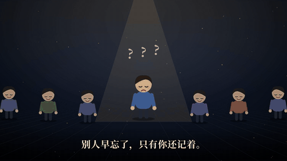
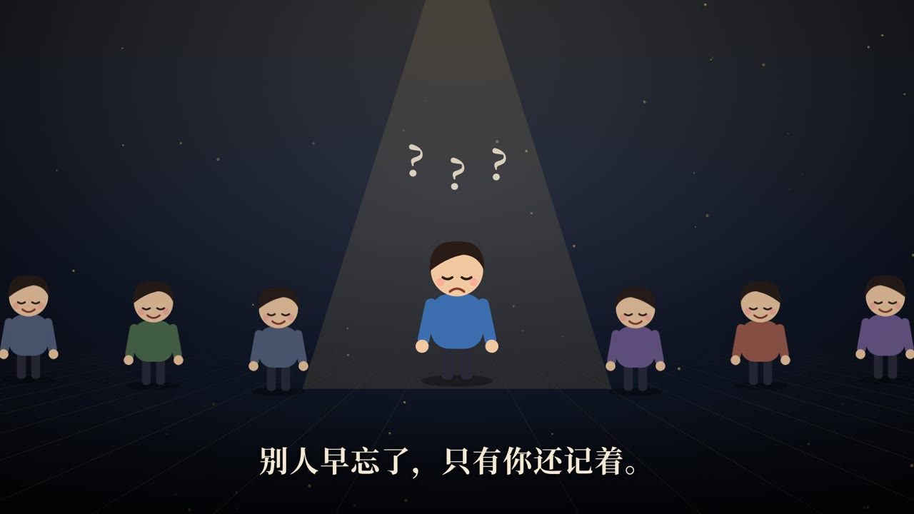
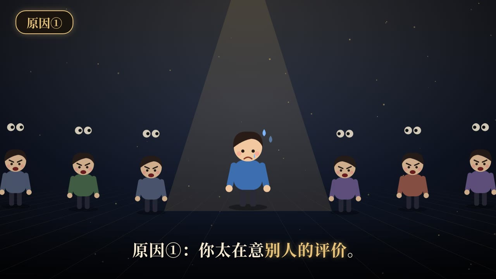
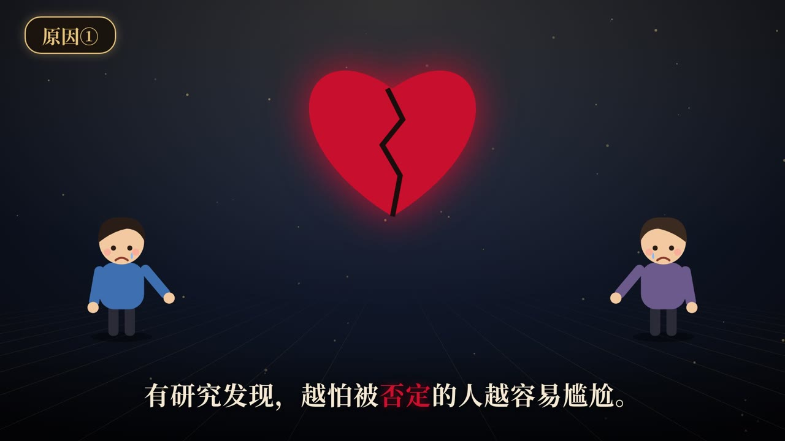

# 心理科普短视频 Skill（psych-kepu-video）

> 🔴 **作者：袁六伟 · 台州汇芯**｜一人 AI 公司创业者，6000+ 学员，100+ 客户，得到/华为分享老师
> 📮 更多 AI 视频与自动化实战，关注 **公众号 / 视频号：袁六伟**

## 效果展示

> 以下画面由本 Skill 自带示例 `embarrassment`（尴尬）直接渲染。



*约 4 秒动图，展示「原因①」段落里人群转为盯视、主角冒汗，再切到碎心场景的动画过渡。*

| | |
|:---:|:---:|
|  |  |
| 3:4 竖版封面（EpCover34），三行大标题加副标题，关键词「尴尬」红色高亮。 | 开场钩子，小人躺在床上反复「回放中…」，插画动画配金色高亮字幕。 |
|  |  |
| 人群场景，聚光灯下的主角头顶冒问号，展示底部居中字幕版式。 | 左上角「原因①」章节标签，人群齐刷刷盯着主角，主角冒汗。 |
|  |  |
| 碎心插画场景，字幕中「否定」用红色强调。 | 结尾 1/2 互动选择卡，引导观众在评论区回复。 |


用 AI agent 批量制作心理学科普短视频：16:9 横屏 1080p、45 秒以内、卡通插画动画、钢琴弦乐配乐，首帧是封面。用 Remotion 渲染，整条片子由一份 JSON 脚本驱动。

*An Agent Skill for short psychology explainer videos, rendered with Remotion and driven by a JSON script.*

## 安装

```bash
npx skills add sixwei2025/psych-kepu-video-skill
```

也可以把 `skills/psych-kepu-video/` 整个文件夹拷进你的 agent 的 skills 目录，Claude Code、Codex、WorkBuddy 等支持 SKILL.md 的 agent 都能用。

## 依赖

- Node 18 及以上
- remotion 和 @remotion/cli 4.0.507、React 19.2.8、TypeScript 5.9.3，版本已在 `package.json` 里写死
- 带 libx264 的 ffmpeg 和 ffprobe
- 中文字体建议装 Noto Serif CJK SC（不随包分发）
- Linux 第一次渲染时会自动下载 Chrome Headless Shell，需要联网

## 快速开始

```bash
cd skills/psych-kepu-video/engine && npm install
bash ../scripts/render.sh ../examples/embarrassment.json
bash ../scripts/qc.sh
```

示例渲染出来是 21.75 秒、1920×1080，首帧是封面。也可以直接对 agent 说：「用 psych-kepu-video 做一条讲『尴尬』的心理科普短视频」。

## 目录

- `SKILL.md`：主流程，包括选题、脚本、渲染、质检、发布节奏
- `engine/`：Remotion 源码
- `scripts/`：`render.sh` 负责渲染，`qc.sh` 负责质检
- `templates/`、`references/`、`examples/`

## 许可

MIT。配乐和字体请使用你自己有授权的资源。

---

## 关于作者

**袁六伟 · 台州汇芯**：一人 AI 公司创业者，6000+ 学员，100+ 客户，得到/华为分享老师。专注 AI 视频与自动化落地。

- 公众号：**袁六伟**
- 视频号：**袁六伟**

这个 Skill 免费开源。觉得有用的话，欢迎点个 ⭐ Star，再关注公众号或视频号「袁六伟」，那里有更多 AI 视频和自动化的实战分享。企业合作也可以通过公众号联系。

更多开源 Skill：[3d-map-video-skill](https://github.com/sixwei2025/3d-map-video-skill)、[dark-infographic-video-skill](https://github.com/sixwei2025/dark-infographic-video-skill)

更多开源 Skill：[talking-head-video-skill](https://github.com/sixwei2025/talking-head-video-skill)
