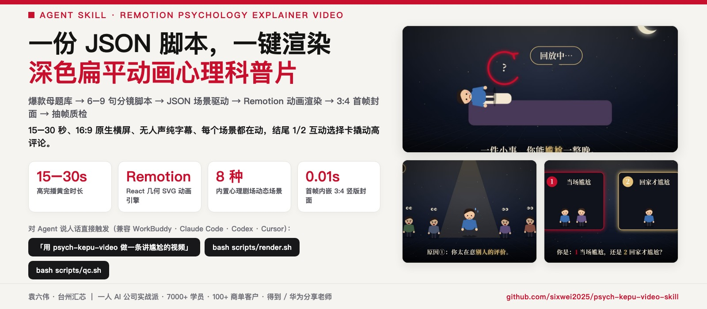
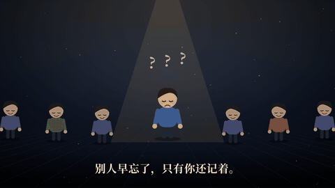
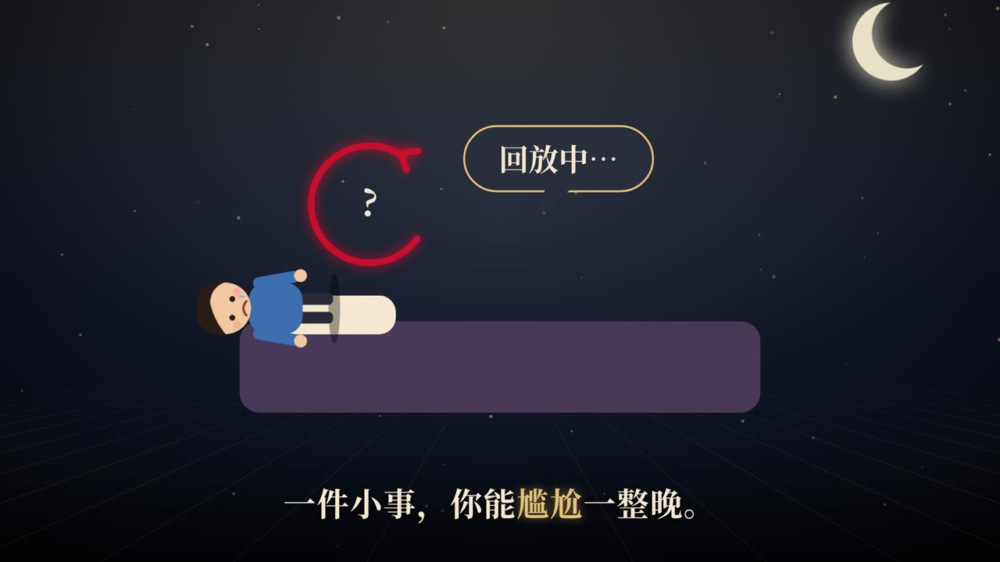
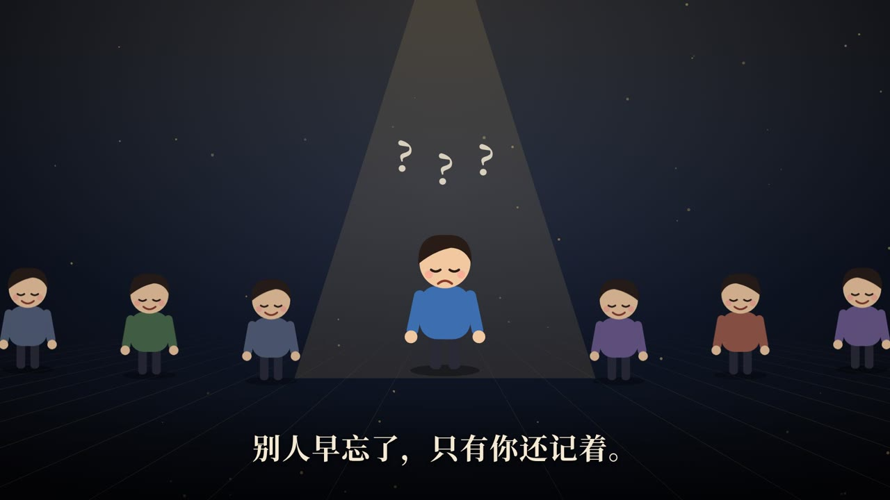
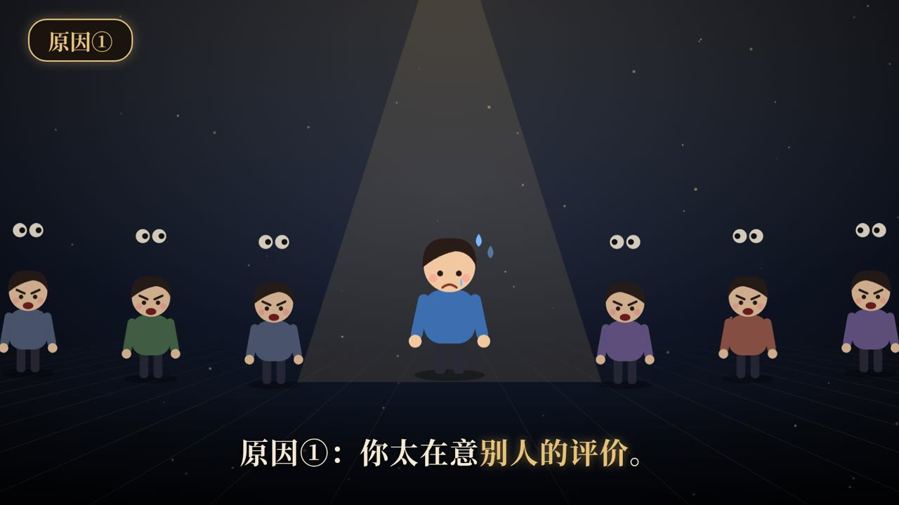
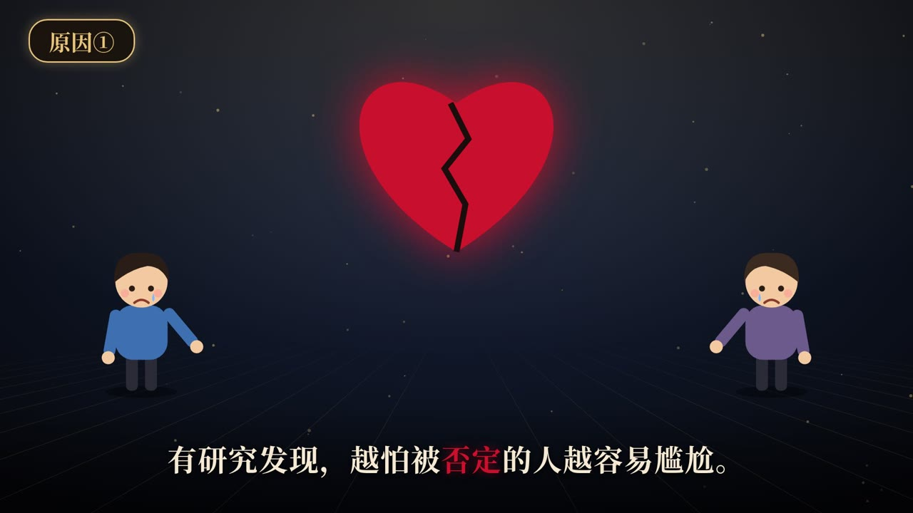
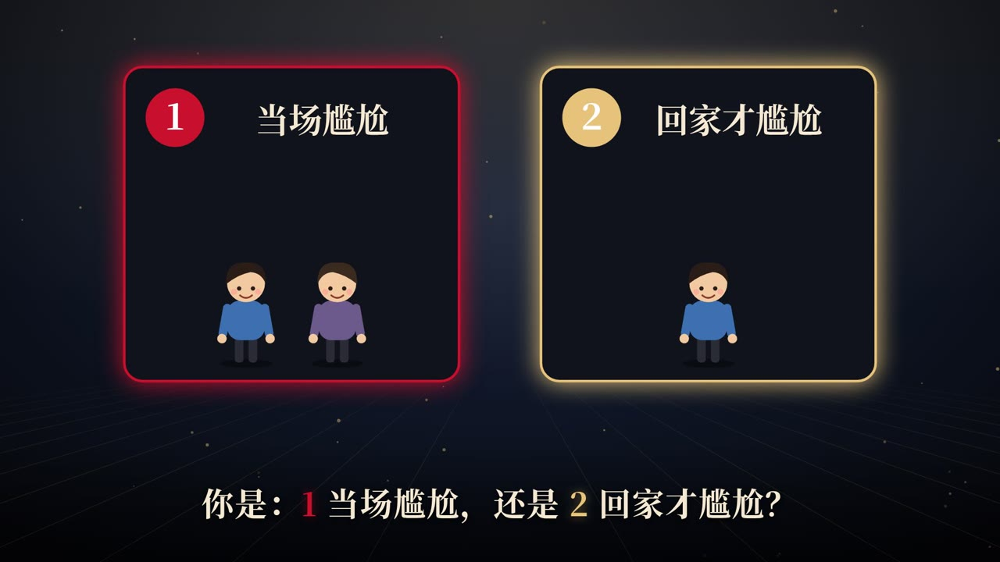
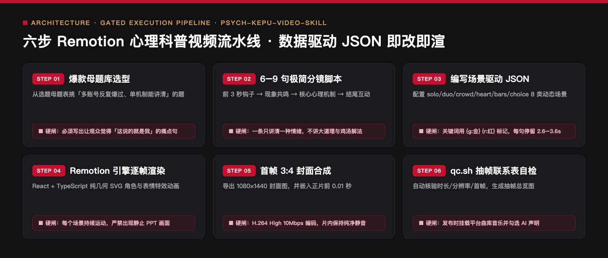

<div align="center">



# 心理科普短视频 Skill
### `psych-kepu-video-skill` · JSON 驱动 + Remotion 逐帧渲染的 15–30s 深色扁平动画心理科普流水线

[](https://agentskills.io)
[](#三json-驱动-8-种视觉组件与流水线架构)
[](#四9-条成片硬标准为什么普通科普视频划走率高)
[](LICENSE)

> 🔴 **作者：袁六伟 · 台州汇芯**｜一人 AI 公司创业者，学员 7000+，客户 100+，得到 / 华为分享老师  
> 📮 更多 AI 工具实测与自动化实战，关注 **公众号 / 视频号：袁六伟**

**改文字不改代码——一份 JSON 配置文件，2 分钟渲染出 1080×1920 竖屏深色扁平动画心理科普短视频。**  
面向抖音、小红书、视频号与 B 站竖屏心理科普账号：内置 **8 套 React 几何动画组件**（独处小人 / 双人对比 / 左右脑博弈 / 75% 人群矩阵 / 情绪柱状图 / 4-7-8 呼吸圆环 / 心率脉冲 / 结尾三选一卡片），自动完成逐句 TTS 测时长、BGM 闪避混音与视频号 `3:4` 封面流嵌入。

```bash
# 方式 A：通过 skills CLI 一键安装（推荐）
npx skills add sixwei2025/psych-kepu-video-skill

# 方式 B：克隆工程并安装 Remotion 依赖
git clone https://github.com/sixwei2025/psych-kepu-video-skill.git
cd psych-kepu-video-skill && npm install
```

[成片动图与分镜展示](#一真实成片动图与-6-幕分镜展示) · [一句话快速开始](#二一句话快速开始) · [流水线与 8 大视觉组件](#三json-驱动-8-种视觉组件与流水线架构) · [9 条成片硬标准](#四9-条成片硬标准为什么普通科普视频划走率高) · [目录结构](#五仓库目录结构)

</div>

---

## 一、真实成片动图与 6 幕分镜展示

> 示例选题：**《为什么你越焦虑越刷手机？》**（`1080×1920` 竖屏 · `30fps` · 深色网格 `#141418` + 霓虹强调色）

<p align="center">
  
</p>

| 01 · 3:4 信息流封面帧 | 02 · 痛点引入（Solo + 气泡） | 03 · 75% 人群共鸣矩阵（Crowd） |
| :---: | :---: | :---: |
|  |  |  |
| **04 · 概念拆解（原因标签拆解）** | **05 · 躯体化反应（心率脉冲动画）** | **06 · 结尾互动（三选一投票卡）** |
|  |  |  |

---

## 二、一句话快速开始

### 1. 在 Agent 中自然语言触发

| 你对 Agent 说的话 | 自动执行的流水线动作 |
| :--- | :--- |
| `帮我做一条「讨好型人格是怎么形成的」心理科普视频` | 自动编写 6 幕 JSON 脚本 → 逐句 TTS 测算真实时长 → 渲染封面与成片 |
| `把 examples/anxiety-scrolling.json 渲染成成片` | 调用 `scripts/build_video.py` 全自动合成配音、BGM、字幕与 `attached_pic` 封面 |
| `启动预览服务器看下动画节奏` | 运行 `npm start` 打开 Remotion Studio 实时调试每一帧弹簧动画 |

### 2. 命令行一键出片

```bash
# 传入任意一集 JSON 配置，全自动生成成片 + 3:4 封面图
python3 scripts/build_video.py examples/anxiety-scrolling.json

# 输出产物：
# output/anxiety-scrolling.mp4        (含流内 attached_pic 封面的最终成片)
# output/anxiety-scrolling-cover.png  (810×1080 独立 3:4 封面图)
```

---

## 三、JSON 驱动 8 种视觉组件与流水线架构

<p align="center">
  
</p>

### 8 种内置深色扁平动画组件（`visual.kind`）

不需要写任何 React 代码，只需在 JSON 的 `scenes[].visual.kind` 中指定组件名：

| `visual.kind` | 适用叙事阶段 | 视觉表现与动效细节 |
| :--- | :--- | :--- |
| `solo` | 开场痛点引入 | 居中火柴人 + 四周浮动高频痛点气泡（`凌晨2点` / `停不下来` / `越刷越累`） |
| `duo` | 行为/状态反差 | 左右双卡片对比（左侧暖红高亮焦虑态 vs 右侧冷灰常态） |
| `compare` | 脑科学/原理解释 | 杏仁核警报 vs 前额叶刹车，带连接脉冲与多巴胺标签 |
| `crowd` | 普遍性共鸣 | 20 人网格点亮动画（如 `75% 的人都有这种防御机制`） |
| `bars` | 情绪/激素曲线 | 动态生长的多维柱状图，直观展示皮质醇与多巴胺反差 |
| `breath` | 实操自救方法 | 4-7-8 呼吸法动态缩放光环，带吸气/屏息/呼气节奏引导 |
| `heart` | 躯体化反应 | 心率脉冲波形动画，配合低频心跳音效提示 |
| `choice` | 结尾评论区促评 | A / B / C 三选一高亮卡片，引导观众在评论区对号入座 |

### 单幕 JSON 配置示例

```json
{
  "tag": "焦虑信号 #01",
  "accent": "#F4B942",
  "headline": ["为什么越焦虑", "越停不下刷手机？"],
  "highlight": "停不下",
  "sub": "不是你自制力差，是大脑在找即时止痛药",
  "tts": "为什么你明明焦虑得睡不着，手指却停不下刷手机？其实不是你自制力差，而是大脑在找即时止痛药。",
  "captions": ["为什么你明明焦虑得睡不着", "手指却停不下刷手机？", "不是自制力差，是大脑在找止痛药"],
  "visual": {
    "kind": "solo",
    "mood": "sad",
    "label": "焦虑循环",
    "chips": ["凌晨 2:00", "再刷5分钟", "越刷越空虚"]
  }
}
```

---

## 四、9 条成片硬标准（为什么普通科普视频划走率高？）

我们在实测抖音、小红书与视频号心理科普赛道爆款后，将以下 **9 条防划走标准** 内置到 `src/PsychVideo.tsx` 与 `scripts/build_video.py` 中：

| # | 硬标准 | 工程实现方式 |
| :--- | :--- | :--- |
| **01** | **深色高反差画布** | 统一 `#141418` 暗色底 + `48px` 极淡网格线（透明度 `4%`），夜间刷手机不刺眼、停留率高 |
| **02** | **黄金 3 色克制法则** | 全片只允许背景深灰 + 纯白正文 + 1–2 个情绪强调色（暖黄 `#F4B942` / 珊瑚红 `#FF6B6B` / 治愈绿 `#4AE290`） |
| **03** | **上字中画下字幕三段构图** | 顶部 `150–420px` 放两行大标题，中部 `450–1380px` 放几何小人舞台，底部 `1480px` 放胶囊字幕，严禁进微信上下裁切死区 |
| **04** | **音画帧级对齐（防抢话）** | 先用 `say -v Tingting -r 195`（或 Edge-TTS）逐句生成音频，用 `ffprobe` 测出真实秒数 + `0.35s` 气口回写 JSON，再启动 Remotion 渲染 |
| **05** | **每 3–4 秒必有视觉状态切换** | 每幕入场采用 `spring(damping:14, stiffness:140)` 弹性缩放，配合微浮动 `sin(frame/12)*4px`，画面绝不静止 |
| **06** | **五段式情绪弧线** | 痛点钩子（0–4s）→ 反直觉定性（4–9s）→ 脑科学拆解（9–16s）→ 30秒微行动（16–22s）→ 评论区选择题（22–26s） |
| **07** | **程序化疗愈环境底乐** | 内置 FFmpeg 合成 C 大调七和弦温暖 Pad（`-22dB`），永远不抢人声、无版权风险 |
| **08** | **3:4 封面信息流安全框** | 渲染第 15 帧作为封面，所有核心大字严格收在中央 `1080×1440`（`3:4`）安全框内，主页网格不裁半边字 |
| **09** | **双通道封面交付** | 同时导出独立 `810×1080` 封面图 + `ffmpeg -disposition:v:1 attached_pic` 视频流内嵌封面 |

---

## 五、仓库目录结构

```text
psych-kepu-video-skill/
├── SKILL.md                          # Agent 技能主协议（9条硬标准 + 分镜编写规范）
├── package.json                      # Remotion 4 + React 18 依赖定义
├── remotion.config.ts                # Remotion 渲染器配置
├── src/
│   ├── index.ts                      # Remotion 入口注册
│   ├── Root.tsx                      # 1080×1920 @ 30fps 画布注册
│   └── PsychVideo.tsx                # 核心组件：网格画布 + 8种几何小人 + 弹簧动效 + 字幕条
├── scripts/
│   └── build_video.py                # 全自动构建脚本：TTS → ffprobe测时 → Remotion渲染 → 混音嵌封面
├── examples/
│   └── anxiety-scrolling.json        # 完整示例：《为什么你越焦虑越刷手机？》
└── assets/showcase/                  # 真实成片动图与分镜截图展示
```

---

## 关于作者与开源生态

**袁六伟 · 台州汇芯**：一人 AI 公司创业者，学员 7000+，服务商单客户 100+，覆盖近 20 个行业，得到 / 华为分享老师。AI 变现实战派，自己跑通才拿出来教。

- 公众号：**袁六伟**（微信搜一搜关注，看更多 AI 工具实测与一人公司实战）
- 视频号：**袁六伟**

这个项目免费开源。如果它帮你的产线省下了每天反复返工的时间，欢迎在右上角点个 ⭐ **Star**，也欢迎转发给身边做内容或一人公司的朋友。

### 同系列开源 Skill 矩阵（袁六伟 · 台州汇芯）

| 仓库 | 领域 | 核心能力 |
| :--- | :--- | :--- |
| [**workbuddy-wechat-autopilot**](https://github.com/sixwei2025/workbuddy-wechat-autopilot) | 公众号全链路 | 九步全自动总控：选题→写稿→真实截图→6套封面→6套排版→三重自动质检→草稿箱 |
| [**wechat-cover-skill**](https://github.com/sixwei2025/wechat-cover-skill) | 公众号视觉 | 封面渲染引擎（6套高客单价杂志风 + 黑红金 v2b + 防压脸自动校验） |
| [**gzh-million-layout-skill**](https://github.com/sixwei2025/gzh-million-layout-skill) | 公众号排版 | 汇芯红 `#C8102E` 六套 100% 内联 CSS 骨架 + 零乱码检查 + 配图皮肤 |
| [**ai-tool-review-wechat-skill**](https://github.com/sixwei2025/ai-tool-review-wechat-skill) | 公众号评测 | AI 工具真跑评测工作流（2.0 全自动压测 + 去碎句语感质检 + 六套骨架装配） |
| [**hit-title-expert-skill**](https://github.com/sixwei2025/hit-title-expert-skill) | 爆款标题 | 一次直出 10 条 14–22 字高浓缩狠标题（5大公式 × 5类钩子词） |
| [**auto-tutorial-skill**](https://github.com/sixwei2025/auto-tutorial-skill) | 短视频工程 | 链接/网页/真机截图 → 3:4 封面 + 1.5x 配音 + 红框标注教程视频 |
| [**talking-head-video-skill**](https://github.com/sixwei2025/talking-head-video-skill) | 短视频工程 | 1080×1920 竖屏真人口播短视频（ASR 错字校对 + 逐字卡拉OK字幕 + 6项QC） |
| [**3d-map-video-skill**](https://github.com/sixwei2025/3d-map-video-skill) | 短视频工程 | MapLibre 3D 地形 + WarFX 战争特效（粒子行军/点阵兵力/震屏混音） |
| [**psych-kepu-video-skill**](https://github.com/sixwei2025/psych-kepu-video-skill) | 短视频工程 | Remotion + JSON 驱动的 15–30s 深色扁平动画心理科普短视频 |
| [**dark-infographic-video-skill**](https://github.com/sixwei2025/dark-infographic-video-skill) | 短视频工程 | 纯 Python + FFmpeg 暗黑流光数据可视化科普片（含 v2 手机外放配乐） |
| [**local-video-hub**](https://github.com/sixwei2025/local-video-hub) | AI 团队基建 | 视频版本地 Obsidian：多 AI 员工统一交片、撞题查重与四态流转云台 |
| [**yuanliuwei-ai-skills**](https://github.com/sixwei2025/yuanliuwei-ai-skills) | 一人公司方法 | PACT 72h 需求验证模型与一人 AI 公司 10 大业务决策模块 |
| [**book-skill**](https://github.com/sixwei2025/book-skill) | 知识工程 | 上传任意书籍 PDF → 自动提炼方法论生成 `.skill` + 公众号导流文案 |
| [**huangdi-skill**](https://github.com/sixwei2025/huangdi-skill) | 认知操作系统 | 中国历史八大皇帝（秦始皇/汉武帝/唐太宗等）一手史料认知框架蒸馏 |
| [**sunrise-tracker**](https://github.com/sixwei2025/sunrise-tracker) | 选题雷达 | 小红书 AI 赛道 10 倍异常流量「低粉爆文」每日早 7 点监测推送 |
